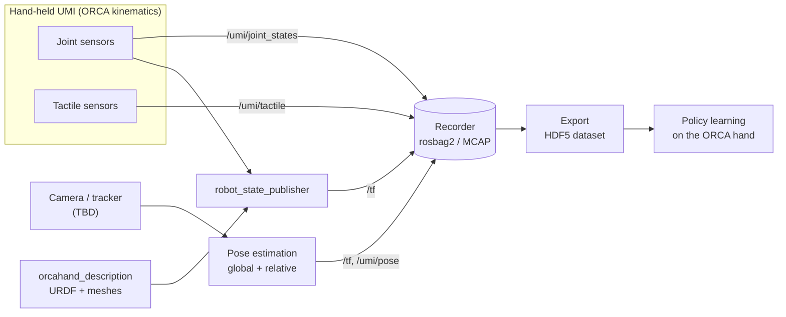

# RWRUMI — a Universal Manipulation Interface for the ORCA hand

**Team 4 · Real World Robotics (RWR)**
Project page: **https://erhell.github.io/RWRUMI/**

RWRUMI is a hand-held data-collection device (a *UMI*) for the dexterous
[ORCA hand](https://orcahand.com). An operator wears or holds the UMI and does a
manipulation task by hand. The UMI uses **the same kinematics as the ORCA hand**,
so what the operator does maps one-to-one onto the robot. While the operator works,
a separate sensing system records:

- **joint angles** from our own joint sensors,
- **contact data** from our own tactile sensors,
- the **global pose** of the UMI (in the world frame) and the **relative pose**
  between the UMI and the manipulated object.

Everything is time-stamped and stored as ROS 2 bags, then exported into a dataset
for learning manipulation policies on the real ORCA hand.

> **Status:** project setup. The repository layout below is the *planned* structure;
> each entry shows whether it already exists.

---

## System overview



| Subsystem | What it does | Owner | Status |
|---|---|---|---|
| Shared kinematics | ORCA hand URDF + meshes, used by every other part | upstream ORCA (git submodule) | planned |
| Joint sensing | Reads our joint sensors and publishes `sensor_msgs/JointState` | Team 4 | planned |
| Tactile sensing | Reads our tactile sensors and publishes a custom tactile message | Team 4 | planned |
| Pose estimation | Global pose of the UMI and relative UMI ↔ object pose | Team 4 | planned (camera/tracker TBD) |
| Recording | Synced recording of all streams to rosbag2 (MCAP) | Team 4 | planned |
| Dataset export | Converts bags into per-episode HDF5 for training | Team 4 | planned |

---

## Repository layout

```text
RWRUMI/
├── README.md                     project overview (this file)
├── docs/                         GitHub Pages project site
│   └── index.html
├── environment.yml               environment: ROS 2 Jazzy + all dependencies (RoboStack)
├── .gitignore
└── src/                          ROS 2 workspace sources                                 [planned]
    ├── external/
    │   └── orcahand_description/ ORCA URDF/MJCF + STL meshes (git submodule)
    ├── rwrumi_interfaces/        custom messages (e.g. TactileArray.msg)
    ├── rwrumi_joint_sensors/     joint sensor driver node
    ├── rwrumi_tactile/           tactile sensor driver node
    ├── rwrumi_pose/              global + relative pose estimation
    ├── rwrumi_recorder/          recording + bag → HDF5 export
    └── rwrumi_bringup/           launch files, configs, RViz setup
```

**Naming conventions (proposed):** packages are prefixed `rwrumi_`; all UMI topics live
under the `/umi` namespace; frames follow [REP 105](https://www.ros.org/reps/rep-0105.html)
(`world` → `umi_base` → hand links from the URDF).

---

## Tech stack

| | |
|---|---|
| OS | Ubuntu 26.04 LTS |
| Middleware | ROS 2 **Jazzy**, installed through [RoboStack](https://robostack.github.io) (conda packages), not apt |
| Environment | `mamba` / `micromamba` with one shared `environment.yml` (ROS, Python and system libraries) |
| Language | Python 3 (`rclpy`) |
| Hand model | [`orcahand/orcahand_description`](https://github.com/orcahand/orcahand_description) (MIT), v2 right hand |
| Recording | `rosbag2` with the MCAP storage plugin |
| Dataset | HDF5 (`h5py`) |
| Pose estimation | TBD (depends on the camera/tracker choice) |

---

## Getting started

> The workspace is not set up yet. These are the intended steps once it is.

No system ROS install is needed. ROS 2 comes inside a conda environment from
[RoboStack](https://robostack.github.io).

```bash
# 1. Install micromamba or Miniforge (once per machine), e.g.
"${SHELL}" <(curl -L micro.mamba.pm/install.sh)
# (with Miniforge, use `mamba` instead of `micromamba` in the commands below)

# 2. Clone including the ORCA submodule
git clone --recursive https://github.com/erhell/RWRUMI.git
cd RWRUMI
# (already cloned without --recursive?)  git submodule update --init --recursive

# 3. Create the environment (ROS 2 Jazzy + all dependencies)
micromamba create -f environment.yml
micromamba activate rwrumi
export ROS_DOMAIN_ID=4             # only talk to our team's ROS nodes on the lab network

# 4. Build and use
colcon build --symlink-install
source install/setup.zsh           # or install/setup.bash, depending on your shell
```

### Keeping everyone's environment identical (no Docker)

| Layer | How it is pinned | How to update after `git pull` |
|---|---|---|
| ROS 2, Python and system libraries | `environment.yml` (versions pinned) | `micromamba env update -f environment.yml --prune` |
| ORCA files | submodule pinned to one commit | `git submodule update --init --recursive` |

To add a dependency, add it to `environment.yml` (conda-forge / RoboStack name, or under a
`pip:` section if it only exists on PyPI), run the update command and commit the file.
Don't `micromamba install` or `pip install` packages by hand, and don't install ROS from
apt as well, so the two installs never get mixed up.

---

## Open decisions

- [ ] Camera / tracker for global pose estimation
- [ ] Method for relative UMI ↔ object pose
- [ ] Joint sensor hardware and interface (serial, I²C, …)
- [ ] Tactile sensor hardware and message format
- [ ] Dataset format details (episode structure, sampling rate)
- [ ] License for our own code

---

## Contributing

- Changes to `main` go through pull requests.
- Only invited collaborators can push; anyone can clone or fork.
- Update this README (and `docs/index.html`) in the same PR whenever you add,
  move or remove a package, or settle one of the open decisions.

## Acknowledgements

- [ORCA hand](https://orcahand.com) and its open-source description, core and hardware repositories (MIT).
- Chi et al., *Universal Manipulation Interface*, RSS 2024 — the original UMI concept.
