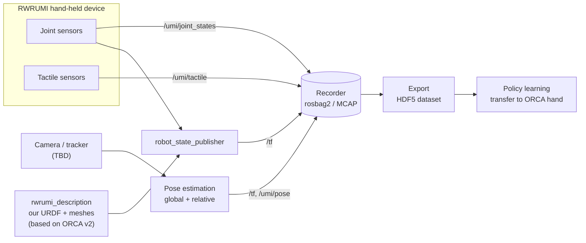

# RWRUMI — a Universal Manipulation Interface based on the ORCA hand

**Team 4 · Real World Robotics (RWR)**
Project page: **https://erhell.github.io/RWRUMI/**

RWRUMI is our own hand-held data-collection system (a *UMI*) for dexterous
manipulation. It is a **separate robotic system**, developed completely by us, but it
is **based on the open-source [ORCA hand](https://orcahand.com)**: we start from ORCA's
kinematic model and meshes and build our own device, sensors and software around them.

An operator holds or wears the UMI and does a manipulation task by hand. Because the
UMI starts from the ORCA hand's kinematics, the recorded motion can be transferred to a
real ORCA hand. While the operator works, the UMI records:

- **joint angles** from our own joint sensors,
- **contact data** from our own tactile sensors,
- the **global pose** of the UMI (in the world frame) and the **relative pose**
  between the UMI and the manipulated object.

Everything is time-stamped and stored as ROS 2 bags, then exported into a dataset
for learning manipulation policies.

> **Status:** development environment ready (ROS 2 Humble via RoboStack). Next: our own
> description package `rwrumi_description` (based on ORCA v2) and the first ROS packages.
> The repository layout below is the *planned* structure; each entry shows whether it
> already exists.

---

## System overview



| Subsystem | What it does | Owner | Status |
|---|---|---|---|
| Robot description | Our own URDF + meshes of the UMI, derived from ORCA v2, used by every other part | Team 4 | planned |
| Joint sensing | Reads our joint sensors and publishes `sensor_msgs/JointState` | Team 4 | planned |
| Tactile sensing | Reads our tactile sensors and publishes a custom tactile message | Team 4 | planned |
| Pose estimation | Global pose of the UMI and relative UMI ↔ object pose | Team 4 | planned (camera/tracker TBD) |
| Recording | Synced recording of all streams to rosbag2 (MCAP) | Team 4 | planned |
| Dataset export | Converts bags into per-episode HDF5 for training | Team 4 | planned |

---

## Relationship to ORCA

RWRUMI is **not** a fork or a plugin of ORCA. It is our own system that **reuses ORCA's
files as a starting point**.

**What we take from ORCA**

| What | From | Where it goes in our repo |
|---|---|---|
| Right-hand URDF (v2) | [`orcahand/orcahand_description`](https://github.com/orcahand/orcahand_description) → `v2/models/urdf/orcahand_right.urdf` | `src/rwrumi_description/urdf/` |
| The STL meshes that URDF uses (16 files, ~23 MB) | `v2/models/assets/right/` | `src/rwrumi_description/meshes/` |
| ORCA's MIT license | `LICENSE` | `src/rwrumi_description/LICENSE.orca` |

Source version: `orcahand_description` commit `b9b349a2`.

**How we use these files**

- **Copied, not linked.** The files are copied into our own package (`rwrumi_description`).
  There is no git submodule and no dependency on ORCA's repositories at build or run time.
- **Ours to change.** We rename the auto-generated link/joint names
  (e.g. `I-PP_bacbd481_to_I-AP-R_d95d02d1` → `index_mcp`) and add our own parts
  (`umi_base`, handle/mount, camera, sensor frames). Mesh paths point to
  `package://rwrumi_description/meshes/…`.
- **Only what we need.** We copy only the v2 right-hand files we actually use, not ORCA's
  whole repository (~512 MB).
- **Documented.** `src/rwrumi_description/SOURCE.md` records where every copied file came
  from (repo, commit, path) and lists **every change we made relative to ORCA**
  (renamed joints, added links, changed dimensions). That list is what lets us map UMI
  data back onto the real ORCA hand.
- **License kept.** ORCA's files are MIT-licensed. Copying is allowed as long as ORCA's
  license text stays with the copied files.
- **No automatic updates.** If ORCA changes its model later, we do not get it automatically.
  We review and copy changes over by hand, only when we want them, and note it in `SOURCE.md`.

**ORCA repositories we use only as reference** (read on GitHub, not copied):
[`orca_core`](https://github.com/orcahand/orca_core) (hand control, kinematics),
[`orcahand_hardware`](https://github.com/orcahand/orcahand_hardware) (CAD/STL, print files),
[`rwr_system`](https://github.com/orcahand/rwr_system) (2024 RWR course ROS code: logger, HDF5 export).

---

## Repository layout

```text
RWRUMI/
├── README.md                     project overview (this file)
├── docs/                         GitHub Pages project site
│   └── index.html
├── environment.yml               environment: ROS 2 Humble + all dependencies (RoboStack)
├── .gitignore
└── src/                          ROS 2 workspace sources                         [planned]
    ├── rwrumi_description/       our robot model, based on ORCA v2
    │   ├── urdf/                 UMI URDF/xacro (ORCA hand + our parts, clean names)
    │   ├── meshes/               STL meshes copied from ORCA (+ our own)
    │   ├── LICENSE.orca          ORCA's MIT license for the copied files
    │   └── SOURCE.md             origin of the copied files + all our changes
    ├── rwrumi_interfaces/        custom messages (e.g. TactileArray.msg)
    ├── rwrumi_joint_sensors/     joint sensor driver node
    ├── rwrumi_tactile/           tactile sensor driver node
    ├── rwrumi_pose/              global + relative pose estimation
    ├── rwrumi_recorder/          recording + bag → HDF5 export
    └── rwrumi_bringup/           launch files, configs, RViz setup
```

**Naming conventions (proposed):** packages are prefixed `rwrumi_`; all UMI topics live
under the `/umi` namespace; frames follow [REP 105](https://www.ros.org/reps/rep-0105.html)
(`world` → `umi_base` → hand links from `rwrumi_description`). Files from other packages
are always referenced by package name (`package://…`, `FindPackageShare`), never by path.

---

## Tech stack

| | |
|---|---|
| OS | Ubuntu 26.04 LTS |
| Middleware | ROS 2 **Humble**, installed through [RoboStack](https://robostack.github.io) (conda packages), not apt |
| Environment | `mamba` (or `micromamba`) with one shared `environment.yml` (ROS, Python and system libraries) |
| Language | Python 3.12 (`rclpy`) |
| Robot model | own package `rwrumi_description`, based on ORCA v2 right hand (MIT) |
| Recording | `rosbag2` with the MCAP storage plugin |
| Dataset | HDF5 (`h5py`) |
| Pose estimation | TBD (depends on the camera/tracker choice) |

---

## Getting started

No system ROS install is needed. ROS 2 comes inside a conda environment from
[RoboStack](https://robostack.github.io).

```bash
# 1. Install mamba (once per machine): Miniforge or micromamba
#    https://github.com/conda-forge/miniforge  (micromamba users: replace `mamba` with `micromamba`)

# 2. Clone
git clone https://github.com/erhell/RWRUMI.git
cd RWRUMI

# 3. Create the environment (ROS 2 Humble + all dependencies)
mamba env create -f environment.yml
mamba activate rwrumi
export ROS_DOMAIN_ID=4             # only talk to our team's ROS nodes on the lab network

# 4. Build and use (from the repo root)
colcon build --symlink-install
source install/setup.zsh           # or install/setup.bash, depending on your shell
```

### Keeping everyone's environment identical (no Docker)

| Layer | How it is pinned | How to update after `git pull` |
|---|---|---|
| ROS 2, Python and system libraries | `environment.yml` (versions pinned) | `mamba env update -f environment.yml --prune` |
| Robot model (incl. ORCA-based files) | committed in `src/rwrumi_description` | nothing extra, it comes with `git pull` |

To add a dependency, add it to `environment.yml` (conda-forge / RoboStack name, or under a
`pip:` section if it only exists on PyPI), run the update command and commit the file.
Don't `mamba install` or `pip install` packages by hand, and don't install ROS from
apt as well, so the two installs never get mixed up.

---

## Open decisions

- [ ] Camera / tracker for global pose estimation
- [ ] Method for relative UMI ↔ object pose
- [ ] Joint sensor hardware and interface (serial, I²C, …)
- [ ] Tactile sensor hardware and message format
- [ ] Dataset format details (episode structure, sampling rate)
- [ ] License for our own code

---

## Contributing

- Changes to `main` go through pull requests.
- Only invited collaborators can push; anyone can clone or fork.
- Update this README (and `docs/index.html`) in the same PR whenever you add,
  move or remove a package, or settle one of the open decisions.
- When you copy or change anything that came from ORCA, update
  `src/rwrumi_description/SOURCE.md` in the same PR.

## Acknowledgements

- [ORCA hand](https://orcahand.com): RWRUMI's robot model is based on ORCA's open-source
  [`orcahand_description`](https://github.com/orcahand/orcahand_description) (MIT, © 2025 ORCA).
- Chi et al., *Universal Manipulation Interface*, RSS 2024 — the original UMI concept.
